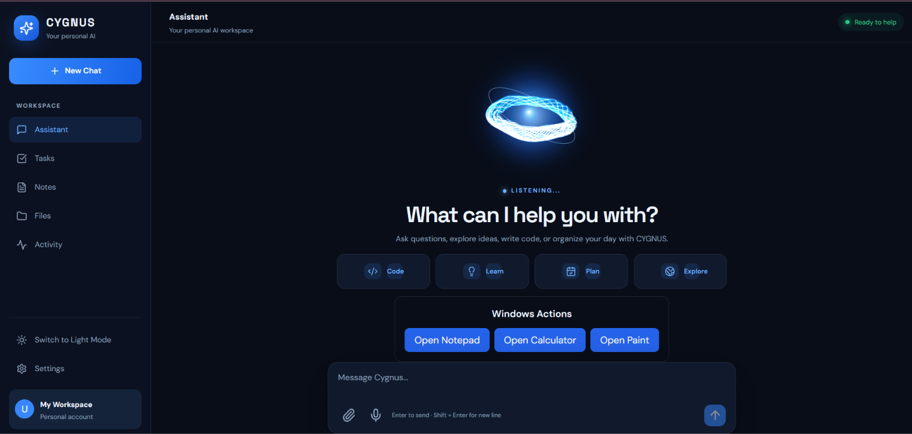
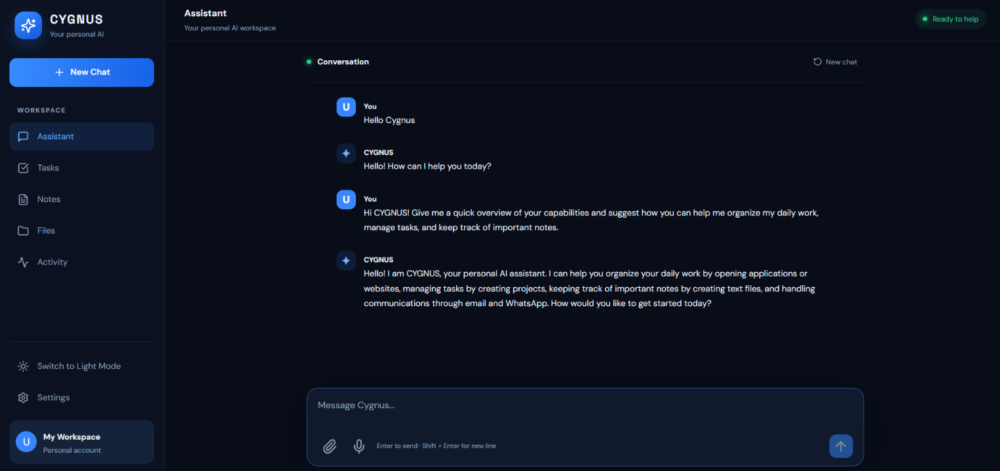
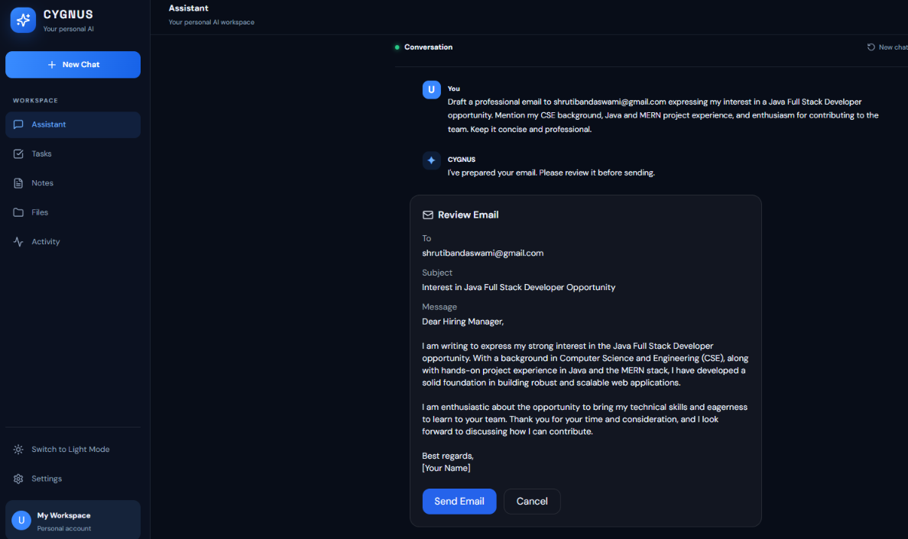
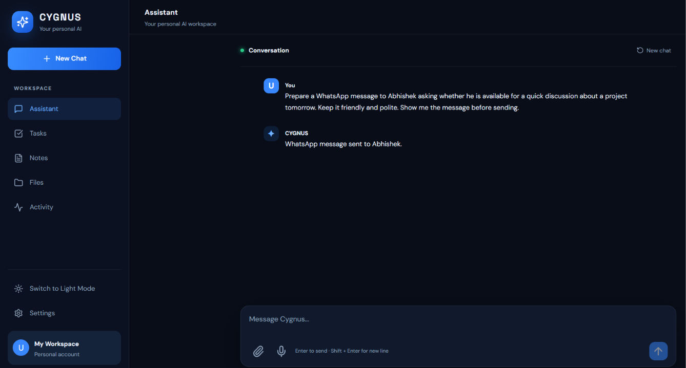
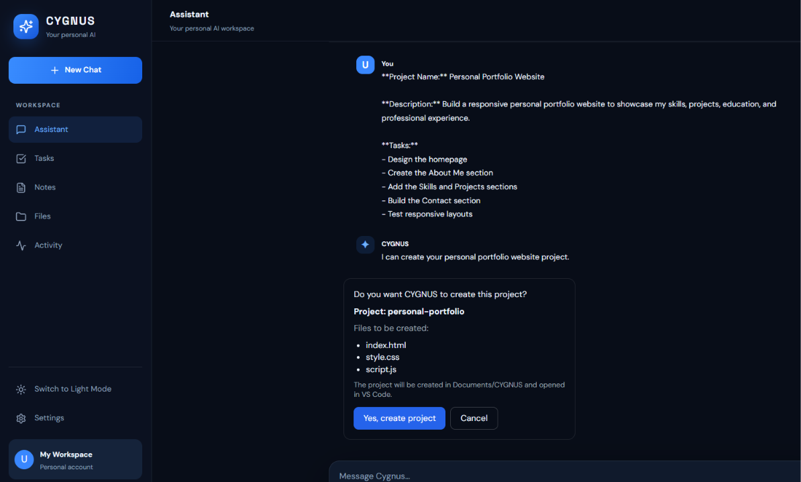
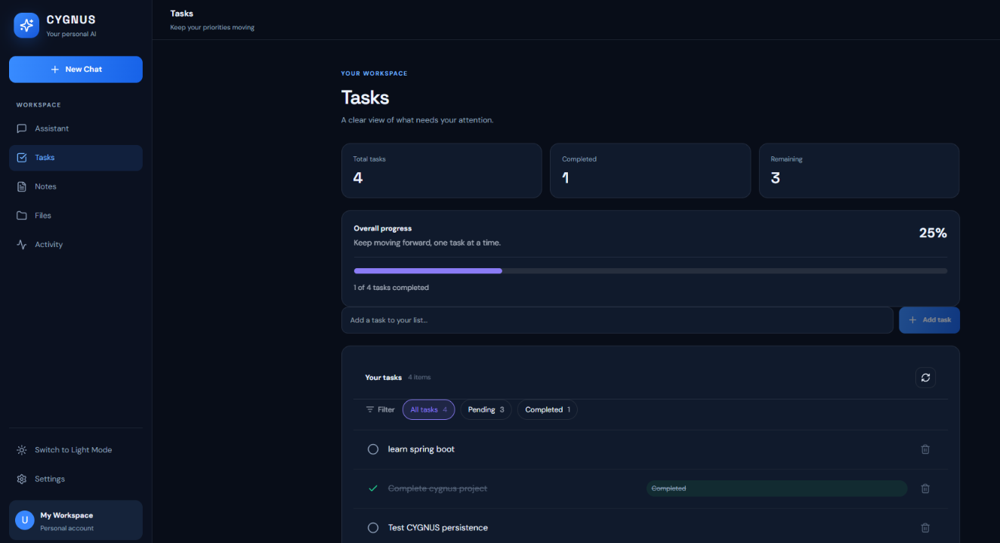

# CYGNUS | Personal AI Assistant

CYGNUS is a personal AI assistant that brings everyday digital tasks into one place. It combines a React web application, a Java Spring Boot backend, and a local Java agent to support conversations, task management, document handling, email workflows, and selected Windows desktop actions.

## Features

### AI Assistant
- Conversational assistant interface.
- Conversation and message management.
- Google Gemini API integration.

### Task Management
- Create, view, update, and delete tasks.
- Organize everyday activities through a dedicated task interface.

### Notes and Documents
- Create, view, edit, search, and delete notes.
- Upload PDF documents.
- Extract and retrieve text from uploaded PDFs using Apache PDFBox.

### Gmail Integration
- Google OAuth-based Gmail connection.
- Send emails through the Gmail API.

### Local Desktop Agent
The Java-based local agent supports selected actions on Windows:
- Launch approved desktop applications.
- Open validated websites in Chrome.
- Create text and code files.
- Generate project folders containing multiple files.
- Open generated projects in Visual Studio Code.

### WhatsApp Integration
- Open WhatsApp Web.
- Prepare messages for a recipient.
- Verify recipient and message details before the automated send action.
- Automated sending is supported through the local agent. Message delivery is not independently verified.

## Tech Stack

| Layer | Technologies |
|---|---|
| Frontend | React, JavaScript, Vite |
| UI | Tailwind CSS, Lucide React |
| Backend | Java, Spring Boot |
| Database | MySQL, Spring Data JPA, JDBC |
| AI Integration | Google Gemini API |
| Document Processing | Apache PDFBox |
| Email Integration | Gmail API, Google OAuth |
| Desktop Automation | Java ProcessBuilder, Playwright |
| API Communication | Axios, REST APIs |
| Build Tools | Maven, npm |

## Architecture

CYGNUS is organized into three main modules:

1. **Frontend:** A React application that provides the user interface and communicates with the backend and local agent.
2. **Backend:** A Spring Boot application responsible for API endpoints, database operations, AI integration, document processing, and Gmail functionality.
3. **Local Agent:** A separate Java Spring Boot application that performs selected desktop and browser actions on the user's Windows machine.

```text
                    CYGNUS
                       |
             React Frontend (Vite)
                       |
             ---------------------
             |                   |
       Spring Boot Backend   Local Java Agent
             |                   |
         MySQL Database      Windows Actions
             |
       External Integrations
         - Gemini API
         - Gmail API
```

## Application Screenshots

### Dashboard


### AI Assistant


### Email


### WhatsApp


### Projects


### Tasks


## Project Structure

```text
CYGNUS/
├── backend/
│   ├── src/
│   ├── pom.xml
│   └── mvnw
│
├── frontend/
│   ├── src/
│   ├── public/
│   └── package.json
│
├── local-agent/
│   ├── src/
│   └── pom.xml
│
├── docs/
│   └── screenshots/
│
├── .gitignore
└── README.md
```

## Running the Project Locally

### Prerequisites

- Windows 10/11
- Java JDK 21
- Maven
- Node.js and npm
- MySQL Server
- Google Gemini API key
- Google Cloud OAuth credentials for Gmail integration, if using Gmail features

### 1. Clone the repository

```bash
git clone https://github.com/Shrutii22/CYGNUS.git
cd CYGNUS
```

### 2. Configure the backend

Configure your MySQL database and provide the required credentials through environment variables.

```powershell
$env:DB_PASSWORD = "your_mysql_password"
$env:GEMINI_API_KEY = "your_gemini_api_key"
```

Configure Gmail OAuth credentials and other required application properties locally. Never commit private credentials or token files.

Start the backend:

```powershell
cd backend
.\mvnw.cmd spring-boot:run
```

### 3. Start the frontend

Open another terminal:

```powershell
cd frontend
npm install
npm run dev
```

Open the local URL printed by Vite.

### 4. Start the local agent

Open another terminal and configure the local agent token:

```powershell
$env:CYGNUS_AGENT_TOKEN = "your_local_agent_token"
```

Start the agent:

```powershell
cd local-agent
.\mvnw.cmd spring-boot:run
```

Configure the matching `VITE_AGENT_TOKEN` in the frontend's local environment file. The frontend and local agent must use the same token.

Check the local application configuration for required ports and other settings before starting all three modules.

## Security

- Keep API credentials and environment-specific configuration outside version control.
- The local agent uses token-based authorization.
- Desktop application launching is restricted to an approved application list.
- Website URLs are validated before opening.
- File and project creation validates names and avoids overwriting existing files.
- Gmail access uses OAuth credentials.

Never publish API keys, OAuth client secrets, access tokens, database passwords, or personal documents.

## Planned Enhancements

- AI-powered PDF explanations and summaries.
- Ask questions about uploaded study material.
- Generate topic-wise quizzes and practice tests.
- Evaluate test responses and provide scores.
- Identify weak topics and track learning progress.
- Improve local-agent capabilities and action handling.

These learning features are planned enhancements. The current document functionality supports PDF upload and text extraction.

## Project Status

CYGNUS is an actively developed personal project combining web-based assistant features, backend services, document handling, and selected local desktop automation.

## Repository

[GitHub: Shrutii22/CYGNUS](https://github.com/Shrutii22/CYGNUS)

---

*Built as a hands-on project to explore full-stack development, Java backend engineering, AI integration, and desktop automation.*